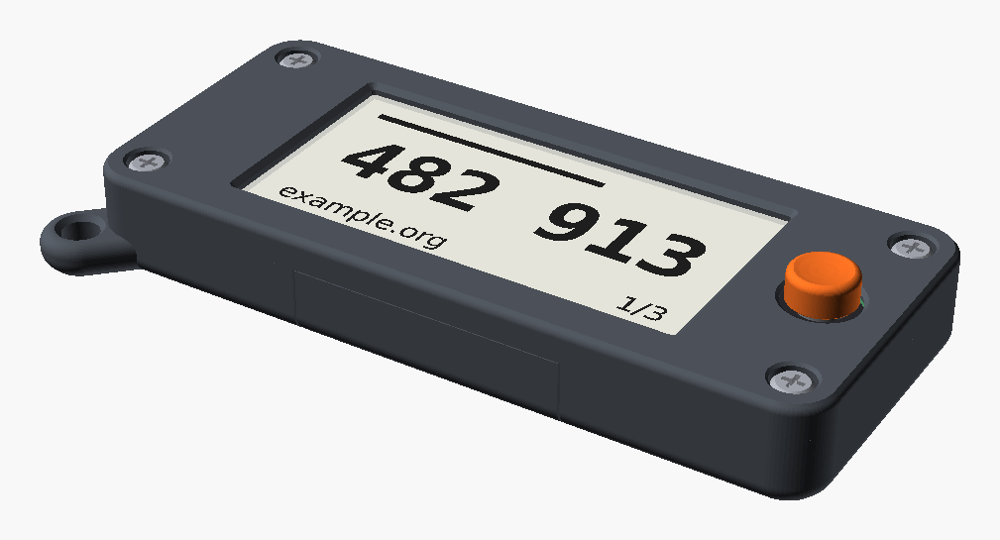
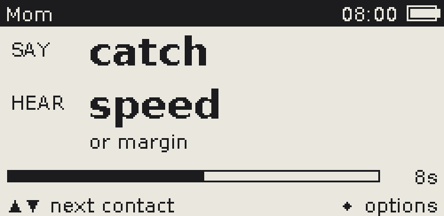
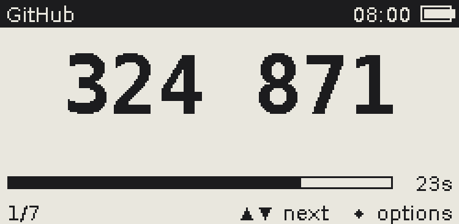
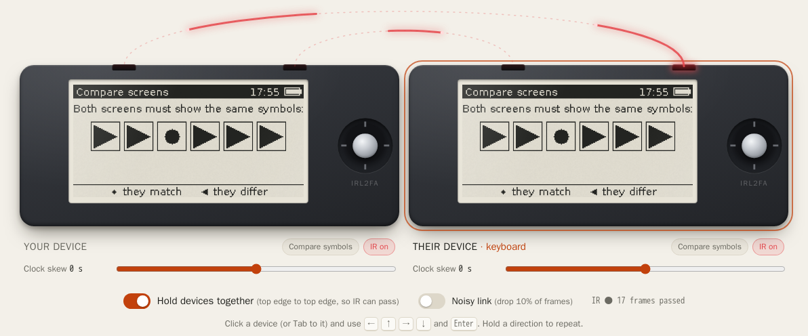

[](https://github.com/gemivnet/IRL2FA/actions/workflows/firmware.yml)
[](https://github.com/gemivnet/IRL2FA/actions/workflows/hardware.yml)
[](https://github.com/gemivnet/IRL2FA/actions/workflows/sim.yml)
[](https://github.com/gemivnet/IRL2FA/actions/workflows/case.yml)


# IRL2FA

**An air-gapped key fob that proves the person on the other end is who they say they are, and keeps your 2FA codes off your phone.**

AI can now clone a voice from a few seconds of audio and write messages in anyone's style. "It's me, I lost my phone, can you send…" is no longer something you can judge by ear. IRL2FA gives two people a shared secret they set up **once, in person**. From then on, each device shows two words that change every 15 seconds: the word you **say** and the word you should **hear** back. If the reply matches, the other person is holding the device you paired with face to face.

It is also a standard **TOTP authenticator** (the 6-digit codes from Google Authenticator and similar apps) for up to 512 accounts. It has no USB data port, no radio and no network. The only control is a 5-way joystick.

<p align="center">
  
</p>

<p align="center">
  <a href="https://irl2fa.com/"><b>▶ Try it in your browser</b></a> ·
  <a href="#build-one">Build one</a> ·
  <a href="docs/pairing-protocol.md">How pairing works</a> ·
  <a href="https://github.com/gemivnet/IRL2FA/releases/latest">Download</a>
</p>

---

## How it works

<p align="center">
  
  
</p>

**Pair once, in person.**

1. Both people choose *Pair with someone* and hold their devices top edge to top edge.
2. The devices agree a 256-bit key over infrared using X25519, with a commitment scheme that stops a man in the middle.
3. Both screens show the same six joystick symbols. You compare them, confirm, and name the contact.

**Verify any time after.**

- Open the contact. Say the **SAY** word; they should answer with your **HEAR** word.
- Words come from HMAC-SHA256 over the current 15-second window, mapped onto the 2048-word BIP-39 list.
- Nothing is ever transmitted again, so there is nothing to intercept.

**TOTP codes.**

- Add an account by typing the base32 secret most sites show under "can't scan the QR code?".
- RFC 6238; SHA1/SHA256/SHA512; 6 or 8 digits; 30 or 60 s.

**Secrets at rest.**

- Every record, labels included, is sealed with XChaCha20-Poly1305 in the MCU's read-protected flash.
- An optional joystick PIN wraps the key with Argon2i. Ten wrong PINs erase the device.

The full design is in [docs/pairing-protocol.md](docs/pairing-protocol.md) and [docs/ui-flows.md](docs/ui-flows.md).

## Try the simulator

The firmware's portable core is compiled to WebAssembly and runs two devices side by side in your browser: pair them over a simulated IR link, compare words, add a TOTP secret and check it against your phone.

**[irl2fa.com](https://irl2fa.com/)**

<p align="center"></p>

## Hardware

| | |
|-|-|
| MCU | STM32U083KCU6: Cortex-M0+, 256 KB flash, 40 KB RAM, TRNG, readout protection |
| Display | 2.13″ e-paper, 250×122, Good Display GDEY0213B74 (SSD1680) |
| Clock | Micro Crystal RV-3032-C7, temperature-compensated ±2.5 ppm |
| Input | Alps SKRHABE010 5-way switch, the only control |
| Pairing | 940 nm side-looking IR LED and phototransistor on the top edge |
| Power | CR2450 coin cell. **About 3.7 years typical, 2.1 years worst case** at 20 uses a day ([calculation](docs/power-calculations.md)) |
| Board | 77 × 31 mm, 2 layers, 0.8 mm, ENIG. JLCPCB can assemble every part except the display |
| Case | 80.9 × 34.9 × 11.0 mm, 3D-printed in 4 parts, M2 screws |

<p align="center">
  
  
</p>

- Design files: [schematic (PDF)](hardware/fab/irl2fa-schematic.pdf) · [KiCad 9 project](hardware/) · [interactive BOM](https://irl2fa.com/ibom.html) · [3D model (STEP)](hardware/fab/irl2fa.step)
- Design notes: [PCB design](docs/pcb-design.md) · [pin assignments](docs/pin-assignments.md) · [why these parts](docs/hardware-options.md) · [design review](docs/design-review.md)

## Build one

You need a PCB, a display, a coin cell, a printed case and four screws. Everything to order is committed and kept current by CI.

1. **Order the assembled board.**
   - At [JLCPCB](https://jlcpcb.com), upload [`hardware/fab/irl2fa-gerbers.zip`](hardware/fab/irl2fa-gerbers.zip).
   - Choose 0.8 mm thickness, the **ENIG** surface finish (a bare pad is the coin cell's negative contact) and PCB Assembly on **both sides**.
   - Add [`irl2fa-bom-jlcpcb.csv`](hardware/fab/irl2fa-bom-jlcpcb.csv) and [`irl2fa-cpl-jlcpcb.csv`](hardware/fab/irl2fa-cpl-jlcpcb.csv).
   - Every part has an LCSC number. The [BOM](docs/bill-of-materials.md) lists prices, stock and alternatives.
   - To solder it yourself, use the [interactive BOM](https://irl2fa.com/ibom.html).
2. **Buy the display.** A [Good Display GDEY0213B74](https://www.good-display.com/product/391.html) (about $5), or the GDEM0213B74WT if it has to work below 0 °C.
3. **Print the case.**
   - Files: [`case/stl/`](case/stl/) or [`case/3mf/irl2fa-all.3mf`](case/3mf/), in PETG or PLA with no supports.
   - Settings and assembly: [docs/case-design.md](docs/case-design.md).
4. **Flash the firmware.**
   - Get `irl2fa-stm32u083-<version>.bin` from the [latest release](https://github.com/gemivnet/IRL2FA/releases), or build it with `firmware/port/stm32u0/build.sh`.
   - Flash it through a Tag-Connect TC2030-NL cable and any ST-Link: [firmware/port/stm32u0/README.md](firmware/port/stm32u0/README.md).
5. **Assemble.**
   - Stick the display to the front of the board.
   - Fold its flex cable through the slot into the connector on the back, slide the CR2450 under its clip from the bottom edge, and screw the case together.
   - Set the time: the device asks on first start.

Built one? Please [file a build report](https://github.com/gemivnet/IRL2FA/issues/new?template=build_report.yml).

> **Status:** v0.1 is a complete, simulated and checked design, but no board has been built yet. The first boards will confirm the panel orientation, the IR range and the real sleep current. Until a build report says otherwise, treat it as a prototype.

## Every change is simulated

The hardware is open to modification, and people order straight from this repository. So every push runs:

- ERC and DRC (with schematic parity)
- every footprint checked against its manufacturer's land-pattern drawing, and its pins against the schematic
- netlist checks against the pin map shared with the firmware
- SPICE simulations of the coin cell, e-paper booster, power switch, reverse-battery protection and IR driver
- the battery-life budget
- a check that the committed Gerbers, BOM and placement files match the KiCad files
- Gerber sanity checks
- case-fit tests
- firmware unit tests (RFC test vectors) and UI flows, with a coverage minimum
- a power cut after every flash operation of every store write, which must leave the old state or the new one
- fuzzing of the IR parser, pairing, the encrypted store, base32 input and the whole app
- constant-time checks of PIN verification, MAC compares and the pairing crypto
- static analysis (cppcheck, clang-tidy) with zero findings
- a formal model of the pairing protocol (Tamarin): the key stays secret and a man in the middle has to commit before he sees an honest key
- the real firmware binary running on an emulated STM32 (Renode), where two virtual devices pair

Details: [docs/hardware-testing.md](docs/hardware-testing.md).

```sh
make check   # everything CI runs, locally (needs Docker)
```

## Repository layout

```
firmware/core/          portable C11: crypto, TOTP, words, pairing, encrypted store, UI
firmware/port/stm32u0/  the device: HAL, SSD1680 and RV-3032 drivers, startup, linker script
firmware/renode/        emulated STM32U083 + peripheral models + Robot tests
firmware/tests/         host unit tests
sim/                    the browser simulator (WebAssembly)
hardware/               KiCad 9 project, pins.yaml, board.yaml, SPICE benches, power model, fab outputs
hardware/lib/           footprints, symbols and 3D models (drawn from datasheets)
case/                   OpenSCAD case, STL/3MF exports, fit tests
docs/                   design documents and images
```

## Why this exists

The original idea (2025): a pocket device that does one thing well, proving that a familiar voice or a familiar account is really the person you know. It has no app, no cloud and no battery to charge every night. The 2026 restart rebuilt the design around what that needs to be safe in practice: a full-strength key exchange instead of a typed code, secrets that never leave the chip, and enough tests that strangers can change it with confidence. See [docs/design-review.md](docs/design-review.md).

**Security notes.**

- A verification word proves possession of a paired device and a clock within about 15 s, nothing more.
- Someone holding your unlocked device can answer for you, which is what the PIN is for.
- Keep the device's clock right: TOTP needs it within about 30 s, and the RTC drifts at most about 80 s a year.
- Report vulnerabilities privately via the Security tab.

## Contributing

Contributions are welcome: firmware, hardware, case, docs, translations of the wordlist. Read [CONTRIBUTING.md](CONTRIBUTING.md) first: `main` must always be orderable, and CI enforces it.

## License

| Part | Licence |
|-|-|
| Firmware and simulator | [AGPL-3.0-or-later](LICENSE) |
| Hardware (schematic, PCB, footprints, models) | [CERN-OHL-S-2.0](hardware/LICENSE) |
| Case | [CC-BY-SA-4.0](case/LICENSE) |

You may use, modify, build and sell all of it, as long as derivatives stay open under the same terms. Third-party components are listed in [THIRD_PARTY.md](THIRD_PARTY.md).
