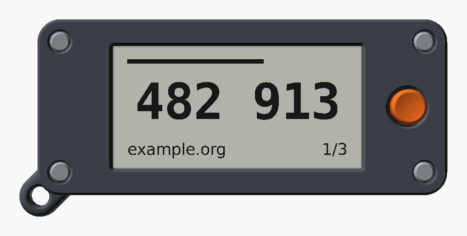
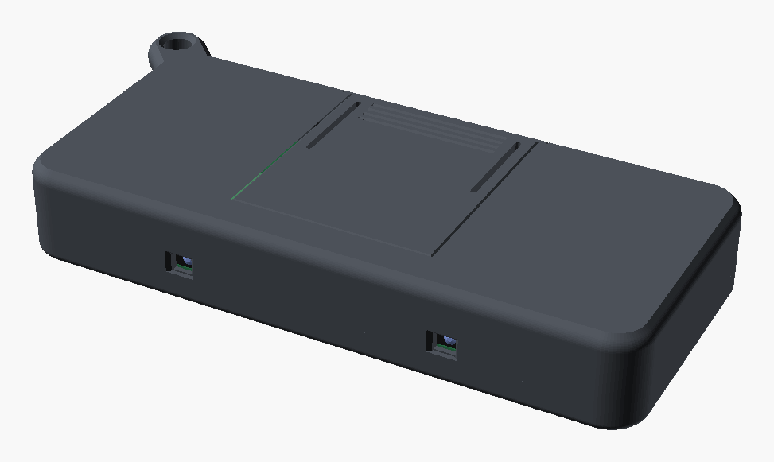
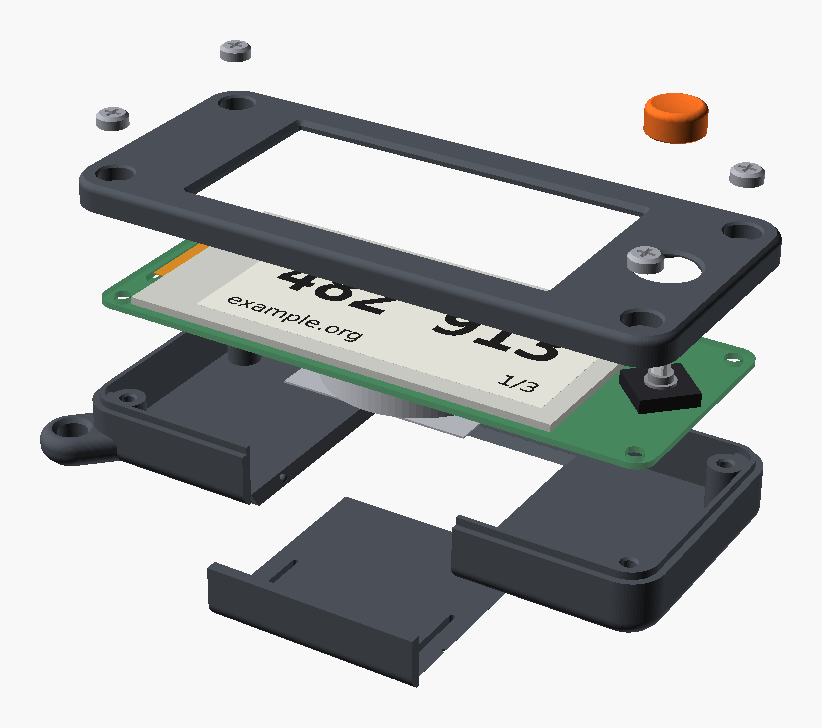

# IRL2FA case

A 3D-printable, screw-assembled enclosure for the IRL2FA board: a slim fob with an
e-paper window, one 5-way joystick, a tool-free CR2450 door, a flat IR edge for
pairing, and a lanyard eye.


| | |
|---|---|
|  |  |

| Item | Value |
|---|---|
| Outer body (W x H x T) | **80.9 x 34.9 x 11.0 mm** (was 83.9 x 37.9 x 13.0 before the 5.7 mm clip and 0.8 mm board) |
| With lanyard tab | 85.7 x 39.7 mm |
| Joystick cap above the front face | 3.15 mm (14.15 mm total at the cap) |
| Printed parts | front shell, back shell, battery door, joystick cap |
| Material | PETG (preferred) or PLA, about 11 g (8.6 cm³) |
| Licence | CC-BY-SA-4.0 (`case/LICENSE`) |

Files:

| Path | What |
|---|---|
| `case/irl2fa_case.scad` | the parametric model (all parameters at the top) |
| `case/board_dims.scad` | **generated** board constants, from `hardware/board.yaml` |
| `case/stl/irl2fa-{front,back,door,cap}.stl` | print-ready parts, already in print orientation |
| `case/3mf/irl2fa-all.3mf` | all four parts on one 220 x 220 plate, one named object each |
| `case/build.sh` | regenerates dimensions, STLs, 3MF and the renders |
| `case/tests/test_case.py` | geometry tests (fit, clearances, walls, printability) |
| `case/tests/test_mechanical.py` | board, part models and case against the manufacturers' drawings |
| `case/tools/` | `gen_dims.py`, `make_3mf.py`, `compare_stl.py`, `postprocess_png.py` |

## Design rationale

**The board is the contract.** Every board-related number (outline, holes, glass,
active area, joystick, IR parts, battery, keep-out height) comes from
`hardware/board.yaml` through `case/tools/gen_dims.py`. The `.scad` never types a
board dimension, so when the PCB changes you regenerate and rebuild; the tests then
tell you whether the case still fits.

**Stack-up** (Z = 0 on the PCB front, screen up):

| Level | z (mm) | From |
|---|---|---|
| Front face | +2.8 | glass top + `part_clearance` + `top_thickness` |
| Glass top | +1.2 | adhesive 0.2 + glass 1.0 |
| Parting line / PCB back | -0.8 | board thickness (0.8 mm) |
| Back cavity floor | -7.0 | PCB back - `back_keepout_height` (5.8) - 0.4 |
| Back face | -8.2 | - `floor_thickness` |

The 5.7 mm CR2450 clip sets the thickness: the 5.0 mm cell plus the clip's
0.25 mm sprung plate and its tongues. The first design used a 7.5 mm moulded
holder (MYOUNG BS-24-B4AA016) on a 1.0 mm board, for a 13.0 mm case. Everything
else is as thin as the 1.2 mm skins and 0.4 mm part clearances allow. See
[hardware-options.md](hardware-options.md#battery-holder) for why the cell does
not sink into the board instead.

**Two shells, one parting line at the PCB back plane.** The back shell is a tub
with a 1 mm alignment lip on the inner half of its wall; the front shell has the
matching rebate, so the seam is light-tight and self-centring. A 0.4 mm V reveal
on the parting line hides print variation. The outer body is one hull of four
revolved corner profiles, split in Z, so both shells share exactly the same
surface. Every bed-facing edge is a round-over that ends in a 45 deg chamfer: it
looks round and prints without supports.

**Four M2 screws clamp everything.** The screws go in from the front through
counter-bores at the board's mounting holes, through the PCB, into bosses in the
back shell (thread-forming, or heat-set inserts with `fastener = "insert"`). The
bosses clamp the PCB between front and back, so the board cannot rattle and there
is no second fastening system. Screwing *into* the front shell was rejected: only
2.8 mm of material exists above the PCB, too little for any M2 thread. The heads
sit 0.4 mm below the face.

**Screen window.** The opening is the active area from `board.yaml` grown by
0.3 mm, with 0.3 mm corner radii and a 0.6 mm 45 deg bezel chamfer. A 1 mm rib
around the glass (0.4 mm clearance) locates its edges and keeps the skin off the
glass. The rib is open over the display's flex, which is wider (14.3 mm, from
6.77 mm below the top glass edge) for its first 4 mm than the 12.5 mm tail, plus
0.5 mm for its position and width tolerances.

**Joystick and cap.** The Alps drawing (SKRH catalog, Drawing No.2) gives the
SKRHABE010 keytop stem as a **1.95 mm square with R0.5 corners, its flats at 45 deg
to the switch body**, from about 3.1 mm to 5.0 mm above the PCB, and allows a cap
to reach at most 1.7 mm down it. Below it are a Ø3 shoulder (to ~3.1 mm) and a
cone on the body (Ø~3.9 to 2.14 mm). The body is turned 45 deg on this board, so
the stem's flats are parallel to the board edges. The cap grips the top 1.7 mm of
the stem in a square socket at that angle, with a crush rib on each face (0.1 mm
interference). Crush ribs are much more forgiving of printer tolerances than a
plain interference bore. Below the socket a flat-roofed bore clears the shoulder
and cone. (Until the mechanical review the socket was sized for a 3.0 mm stem
turned the other way, from a third-party model: it would not have gripped at all;
see [mechanical-review.md](mechanical-review.md), MECH-02.) The skin is relieved
to 0.6 mm over the switch body, and the hole leaves a 0.4 mm radial gap so the
cap can tilt in all four directions: the switch tilts 0.25 mm at 4.3 mm height
(about 3.8 deg about a pivot 0.49 mm above the board), which moves the cap only
about 0.15 mm at the hole. The stem top is 5.0 mm above the PCB, which is 2.2 mm
above the case face. With a 0.6 mm roof and a 0.3 mm finger dish, the cap rim
therefore sits **3.15 mm** above the face, not the 1.5 mm we aimed for. The model
raises `cap_protrusion` automatically and prints a note. A lower-stem SKRH
variant would allow a flatter cap. The cap is held by the press fit alone; if a
print comes out loose, raise `stem_rib_interference` or add a drop of glue.

**IR edge.** The emitter and detector are side-lookers on the back, aimed through
the top edge, with their lens tips on the board edge. The top edge is a flat face
with no tab or screw head on it, so two devices placed screen-up, one turned
180 deg, butt flat together. Each lens is then 0.35 + 1.6 = 1.95 mm from its outer
face, so emitter to detector is **3.9 mm**. The windows are notches in the top edge
of the back-shell wall, so they need no bridges. Each is 3.0 x 2.6 mm, sits at the
part's x and covers the PCB back down to 2.6 mm (the lens centre is about 1.15 mm
below the PCB). Each has a 0.5 mm outward chamfer. `ir_window = "thin"` instead
leaves a 0.6 mm skin: print the back shell in an IR-transparent filament (many
black PETGs pass 850-940 nm; check yours with a phone camera) and the edge is
fully closed.

**Battery door: slide, not bayonet.** A bayonet needs lugs and ramps *behind* the
floor, which would add about 1.5 mm of thickness, or space beside the clip that
does not exist. A slide door works within the 1.2 mm floor. It has 45 deg dovetail
rails on both sides and a dovetailed leading edge, and it prints flat with no
overhang beyond 45 deg. It carries its own section of the bottom wall, so the
case has no 30 mm bridge over the slot. A sprung detent (relief slots behind each
rail and a 0.45 mm bump on the case rail) holds it closed. Four grip grooves let
you slide it open with a thumb; a coin also works.

The MYOUNG MY-2450-01 clip is a sprung plate over the cell with a stop at its
closed end, which points at the IR edge. The cell lies on a bare copper pad (its
negative contact) and slides in and out along the board through the clip's open
end, which faces the bottom edge. The door opening is the cell plus 1.5 mm on each
side (27.5 mm), from 1 mm above the cell's top edge to the bottom of the case, and
the door carries the matching section of the bottom wall. With the door out, the
bottom wall is open over the full cell width, so the cell slides straight out. The
door's wall section then stops the cell sliding out of the clip in use.

**Lanyard.** A 4 mm-thick rounded tab at the bottom-left corner with a chamfered
Ø4 mm eye (`lanyard_corner = "right"` moves it). It belongs to the back shell,
prints flat, and stays well clear of the IR edge.

## Bill of materials (case only)

| Qty | Part | Notes |
|---|---|---|
| 4 | M2 x 6 pan or cheese head screw | `fastener = "selftap"` (default): thread-forming for plastics (e.g. DIN 7985 form H in A2, or "PT"/"Delta PT" M2 x 6). Head Ø ≤ 4.0 mm, height ≤ 1.6 mm. |
| 4 | M2 x 3 heat-set insert, OD ~3.2-3.5 mm | only with `fastener = "insert"`; then use M2 x 6 machine screws (ISO 7045 / DIN 7985) |
| 1 | Lanyard, split ring or keyring | the eye takes a Ø4 mm cord or a ≤ 1.5 mm wire ring |
| 1 | CR2450 cell | not part of the case, listed for completeness |

## Printing

| Setting | Value |
|---|---|
| Material | PETG (tougher, better for the sprung door and the clip-on cap); PLA works |
| Nozzle / layer height | 0.4 mm / 0.2 mm (0.12-0.16 mm for the cap if you want a smoother dish) |
| Perimeters | 3 (the 1.2-1.6 mm walls come out solid) |
| Top / bottom layers | 5 / 4 |
| Infill | 25 % gyroid (only the bosses and lanyard tab have any) |
| Supports | none: every overhang is ≤ 45 deg and every bridge ≤ 10 mm (the tests check both) |
| Brim | none, except a 3 mm brim for the cap on a slippery bed |
| Elephant-foot compensation | 0.15 mm, so the front face edges and window stay crisp |

Orientation: the STLs and the 3MF are already oriented. For reference:

| Part | Face on the bed |
|---|---|
| front | the front face (screen side) |
| back | the back face |
| door | its outer face (the wall section points up) |
| cap | its flat bottom (socket opening down) |

Print the front shell in the colour you want people to see. A contrasting cap
(the renders use orange) makes the only control obvious.

## Assembly



1. **Inserts (only with `fastener = "insert"`):** press the four heat-set inserts
   into the back-shell bosses with a soldering iron at about 220 deg C, flush with
   the boss tops.
2. **Board into the back shell:** the display must already be on the board, its
   flex threaded through the slot and locked in J1 (README, "Build one"), with
   the spare length as a loose loop under the board. Flash the firmware now: J3
   is on the back and cannot be reached once the board is in the case. Then drop
   the PCB, back side down, into the back shell. It rests
   on the four corner bosses. The IR emitter and detector must face the edge with
   the two small windows.
3. **Front shell:** lay it over the board so the glass sits inside the locating
   rib and the joystick comes through its hole. The lip and rebate centre it.
4. **Screws:** drive the four M2 x 6 screws through the front corners. Stop when
   the head seats: thread-forming screws strip PLA easily, so snug is enough.
5. **Cap:** push the joystick cap onto the stem with the socket's flat sides
   matching the stem (the stem's flats are parallel to the case edges). Press straight
   down while supporting the board from behind, until the cap stops on the stem
   top.
6. **Battery:** slide the door off towards the bottom edge (grip grooves, thumb
   pressure). Hold the CR2450 with its positive (marked) side facing you, away
   from the PCB, and slide it flat along the board through the bottom opening,
   under the clip, until it stops against the clip's closed end. Slide the door
   back on until it clicks.

To change the cell, slide the door off. Put a fingernail in the notch at the
clip's open end and slide the cell out through the bottom opening.

To reflash, take out the four screws and lift the board out of the back shell
(the display stays on it): the Tag-Connect pads (J3) are on the back, under the
back shell, and the battery door does not reach them.

## Changing parameters

Open `case/irl2fa_case.scad` in OpenSCAD 2021.01 or newer. All parameters are at
the top, grouped and commented, and show in the Customizer. The important ones:

| Parameter | Default | Effect |
|---|---|---|
| `fit_clearance` | 0.25 | printed part to printed part (lip/rebate, door rails) |
| `pcb_clearance` | 0.35 | PCB outline to inner wall |
| `part_clearance` | 0.40 | components (glass, joystick, back parts) to case; the tests require ≥ 0.3 |
| `wall`, `top_thickness`, `floor_thickness` | 1.6 / 1.2 / 1.2 | shell thicknesses |
| `edge_r_front`, `edge_r_back` | 1.0 / 2.0 | perimeter round-overs |
| `window_margin`, `bezel_chamfer` | 0.3 / 0.6 | screen opening |
| `cap_d`, `cap_gap`, `cap_protrusion`, `cap_dish` | 7.0 / 0.4 / 1.5 / 0.3 | joystick cap; protrusion is raised if the roof would be < `cap_roof` |
| `stem_shape`, `stem_socket_extra`, `stem_rib_interference` | "square" / 0.2 / 0.1 | cap socket (use "round" for a round-stem switch) |
| `fastener` | "selftap" | "selftap" or "insert" |
| `ir_window` | "open" | "open" (chamfered notch) or "thin" (0.6 mm skin, IR-clear filament) |
| `ir_window_w`, `ir_window_h` | 3.0 / 2.6 | IR window size |
| `door_margin`, `detent_protrude` | 1.5 / 0.45 | battery opening and detent strength |
| `lanyard_corner` | "left" | "left" or "right" (both bottom corners) |

Export a single part from the command line:

```sh
openscad -D 'part="back"' -D 'fastener="insert"' -o back.stl case/irl2fa_case.scad
```

Parts: `front`, `back`, `door`, `cap` (print-oriented), `assembly`, `exploded`
(with PCB, display, joystick and battery placeholders), and `info` (echoes the
JSON the tests use).

### When `board.yaml` changes

```sh
case/build.sh                         # regen dims + STLs + 3MF + renders (docker)
.venv/bin/python -m pytest case/tests # check the fit
```

`build.sh` runs `gen_dims.py`, then exports the four parts in parallel inside the
`openscad/openscad:latest` container (it uses `--backend=manifold` automatically
on images that have it). It writes `case/stl/irl2fa-case-info.json`, packs the
3MF with `trimesh`, and renders the PNGs under Xvfb. Use
`case/build.sh --no-render` to skip the renders. The Python side needs
`pip install -r case/requirements.txt`; the repo `.venv` is used when present.

## Tolerance tuning

Print the **cap** and the **door** first: they are small and test the two
tolerance-critical fits.

- **Cap too loose / falls off:** raise `stem_rib_interference` by 0.05. **Too
  tight / cracks:** lower it, or lower `stem_socket_extra`. PETG forgives more
  than PLA.
- **Door rails bind:** raise `fit_clearance` to 0.3. **Door rattles:** lower it
  to 0.2. **Detent too weak or too strong:** change `detent_protrude` in 0.1 mm
  steps, or `relief_beam` (a thinner beam is softer).
- **Shells will not close over the lip:** raise `fit_clearance`. The lip is
  `wall/2 - fit_clearance/2` thick.
- **PCB tight in the shell:** raise `pcb_clearance`. Check for elephant foot
  first: it shrinks the cavity at the first layers of the back shell.
- **Self-tapping screws spin:** reduce `pilot_d` to 1.6. **Bosses split:** raise
  it to 1.8, or switch to heat-set inserts.
- **Cap rubs the hole when tilted:** raise `cap_gap`.

Changing a value from the table above does not need a test update: the tests read
`irl2fa-case-info.json` and `board.yaml`.

## Tests and CI

`case/tests/test_case.py` (pytest, trimesh + manifold3d) checks the built STLs:

- every part is watertight, consistently wound, a single body, accepted by
  manifold3d, has positive volume, fits a 220 x 220 bed and lies flat on a large
  face;
- printed parts do not overlap each other in the assembly;
- sampled wall thicknesses (floor, skin, side walls, door) are ≥ 1.2 mm;
- every part from `board.yaml` grown by 0.3 mm leaves zero intersection volume
  with every printed part. The parts are glass, joystick body and collars, FPC,
  PCB outline, and the whole back keep-out prism outside the screw-boss zones;
- the cap keeps ≥ 0.3 mm from the hole and stands ≥ 1.5 mm proud;
- rays over the whole active area pass through the window;
- the joystick hole centre is within 0.2 mm of the stem;
- the IR windows are within 0.3 mm of the emitter and detector x;
- the top edge is flat, nothing protrudes past it, and the emitter-detector
  distance is ≤ 5 mm;
- no overhang is steeper than 45 deg and no bridge is longer than 10 mm;
- `board_dims.scad` matches `board.yaml`.

`case/tests/test_mechanical.py` checks the board and our models against the
manufacturers' drawings (sources and pages in the file and in
[mechanical-review.md](mechanical-review.md)):

- our part models, as placed on the board (`hardware/fab/irl2fa.glb`, exported by
  `make fab`), have the drawing dimensions: glass, flex flare and stiffener,
  joystick stem and body, FPC connector, battery clip, IR parts;
- no part model reaches into a printed part in the assembled position (only the
  cap's crush ribs on the stem);
- the display flex fits its slot, folds clear of its glued root, reaches J1 and
  lines up pin 1 to pin 1;
- the cap socket matches the stem's size, angle and fitting length, and the 45 deg
  turn gives the joystick directions in `hardware/pins.yaml`;
- the coin cell lands on its pad and nothing lies in its insertion path.

Requirements the current board does not meet yet are `xfail` with their finding
ID.

`.github/workflows/case.yml` runs on pushes and PRs that touch `case/`,
`hardware/board.yaml` or the workflow. It:

1. regenerates `board_dims.scad` and fails if the committed copy is stale;
2. rebuilds everything with the OpenSCAD container;
3. fails if the committed STLs are stale. OpenSCAD's STL output is not
   byte-stable, so `compare_stl.py` compares triangle count, bounding box and
   volume within 0.1 %;
4. runs the tests and uploads the renders, STLs and 3MF as an artifact.

## Assumptions not in `board.yaml`

These come from datasheets or STEP models in `hardware/lib/` and are parameters in
the `.scad`:

- SKRH keytop stem: 1.95 mm square, R0.5, flats at 45 deg to the body
  (`stem_square`, `stem_corner_r`, `stem_angle`), at most 1.7 mm into the cap
  (`stem_fit_max`); collars Ø3.9 mm to 2.14 mm and Ø3.0 mm to 3.12 mm
  (`joystick_collars`). From the Alps drawing; `board.yaml` only has the 3.0 mm shoulder.
- GDEY0213B74 flex flare: 14.30 mm wide from 6.77 mm below the top glass edge
  (`fpc_flare_w`, `fpc_flare_y`, Good Display drawings).
- The back side is clear within Ø5.3 mm of each mounting hole and in the corner
  quadrant outside it, because the case bosses sit there.
- The front side carries nothing except the display, its FPC and the joystick.
  The glass rib reaches down to 0.7 mm above the PCB front.
- IR lens centre about 1.15 mm below the PCB back, lens Ø ≈ 1.8 mm (Vishay
  VSMB2948SL / VEMT2523SLX01 STEP).
