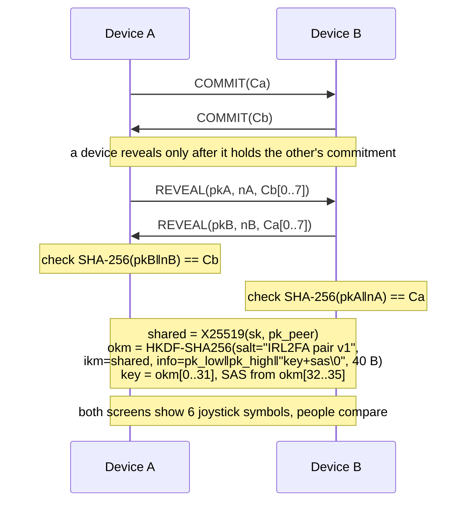

# Pairing protocol

Two IRL2FA devices pair once, in person, over a short infrared link. They
end up with the same 256-bit **contact key**. From then on, each device can
show the **verification words** for that contact without any further link.

The code is in [`firmware/core/pairing.c`](../firmware/core/pairing.c),
[`firmware/core/words.c`](../firmware/core/words.c), and the tests in
[`firmware/tests/test_device.c`](../firmware/tests/test_device.c).

## Why not a typed code?

The original design had both people type a 20-symbol joystick code (5^20 ≈
2^46). Someone who overheard a few exchanged words could test every possible
seed offline, and 2^46 is a few GPU-days. Typing a long enough code (about 55
symbols for 128 bits) would be miserable. A key agreement over a link that
only works at a few centimetres gives a full 256-bit key, and nobody types
anything.

## The link

| | |
|-|-|
| Medium | 940 nm IR, side-looking LED and phototransistor on the top edge |
| Range | a few cm; the devices are held top edge to top edge |
| Coding | plain UART, 4800 baud 8N1, inverted (idle = LED off) |
| Framing | `'I' '2' type len payload[len] crc16` (CRC-16/CCITT-FALSE over type..payload) |

The link is half-duplex and lossy: the phototransistor also sees its own LED,
so a frame that arrives while the receiving device is transmitting is lost.
Every frame is resent about every 0.25 s (220 ms plus 0-127 ms of random
jitter). A device ignores its own echo, and a frame with a bad CRC is
dropped.

**Listen before talk.** A COMMIT takes 79 ms on the air and a REVEAL 129 ms, so
without care the two devices' frames overlap most of the time. A device
therefore only starts a frame when no byte from the other device has arrived
for 6 ms (about three byte times; bytes heard while its own frame is in the
air are its echo and do not count). Otherwise it backs off 4-35 ms at random
and listens again. In the browser simulator's link model (byte-by-byte
airtime, half duplex), over the same 60 random seeds:

| | 2 cm: median / 90 % / worst | 2 cm: never completes | 8 cm: median / 90 % / worst | 8 cm: never completes |
|-|-|-|-|-|
| Without listen-before-talk | 6.9 s / 14.0 s / – | 2 of 60 | 6.4 s / 14.1 s / – | 2 of 60 |
| With it | 2.5 s / 2.9 s / 3.2 s | 0 | 2.6 s / 3.1 s / 3.6 s | 0 |

Without it, a device whose REVEALs keep colliding hits the 15 s REVEAL
timeout below and shows *Pairing failed*.

**Giving up.** A device still looking for the other after 60 s (nobody there,
or out of range) stops, says *No other device found* and returns to the
menu. Pairing holds off the idle timeout for at most three minutes from the
start (comparing and naming take a while), then the device sleeps as usual.

## Messages

| Type | Payload | Meaning |
|-|-|-|
| 1 `COMMIT` | `C = SHA-256("IRL2FA commit v1" ‖ pk ‖ n)` (32 B) | commits to my public key before I see yours |
| 2 `REVEAL` | `pk` (32) ‖ `n` (16) ‖ first 8 bytes of the peer's `C` | opens my commitment, addressed to the peer |

`pk` is a fresh X25519 public key and `n` a fresh 16-byte nonce. Both come
from the MCU's true random number generator.

## Sequence



- **Roles.** The device whose public key sorts lower is the *low* side. The
  role decides which word each person says.
- **SAS.** The short authentication string is six symbols from {↑ → ↓ ← ●}.
  They are the base-5 digits of a 32-bit value: 5^6 = 15,625 outcomes. Both
  people check that their screens match, then press ●.
- **Why the commitment matters.** An attacker in the middle (Mallory) has to
  send a commitment to each side before seeing that side's key. So Mallory
  cannot grind keys until the two SAS values collide; the attack succeeds
  with probability 1/15,625 per attempt, and every attempt is visible as a
  failed pairing: a device waiting more than 15 s for the other's REVEAL
  gives up and shows *Pairing failed*, and the SAS screen tells people to
  cancel on both devices if the other shows no symbols (see
  [formal-verification.md](formal-verification.md#findings)). This is the same idea as ZRTP's hash commitment and
  Bluetooth's numeric comparison.
- **Retransmission.** A device keeps sending COMMIT and REVEAL alternately
  until its owner confirms or cancels. That way the peer recovers from any
  lost frame. The tests run the exchange with 20-50 % random frame loss.

## Contact words

Every 15 seconds, each device computes:

```
mac   = HMAC-SHA256(key, "IRL2FA words v1" ‖ uint64_be(floor(unix_time / 15)))
a     = mac bits 0..10    → word for the low side to SAY
b     = mac bits 11..21   → word for the high side to SAY (re-drawn if equal to a)
```

Words come from the 2048-word BIP-39 English list (11 bits each). The low
side shows `SAY a / HEAR b` and the high side shows `SAY b / HEAR a`. The
contact screen also shows the previous window's HEAR word ("or …"), so a
reply that arrives just after the rollover, or a clock a few seconds off,
still verifies.

**What a word proves.** The person you're talking to holds a device that was
paired with yours in person, and its clock is within about 15 s of yours.
Someone who only sees past words learns nothing useful: without the 256-bit
key, words are unpredictable.

## Keys at rest

The contact key and its name are stored in an encrypted record (see
[`store.h`](../firmware/core/store.h)): XChaCha20-Poly1305 under a random
master key held in the MCU's read-protected flash. If you set a PIN, the
master key is also wrapped with Argon2i(PIN). Ten wrong PINs erase the store.

## Limits

- A device's clock must be within about ±15 s of the other's. The RV-3032
  drifts at most about ±79 s a year (±2.5 ppm), so set the time when the
  words start disagreeing. Both TOTP and words use UTC.
- Pairing proves possession of a device, not who is holding it. Someone who
  steals and unlocks your device can answer for you, which is what the
  optional PIN is for.
- The protocol has no forward secrecy across contacts: a leaked contact key
  exposes that contact's past and future words, and nothing else.
