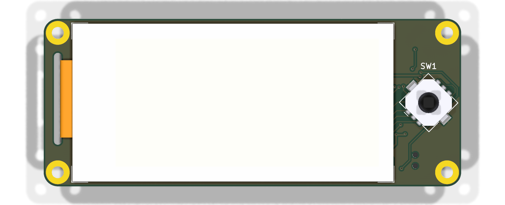
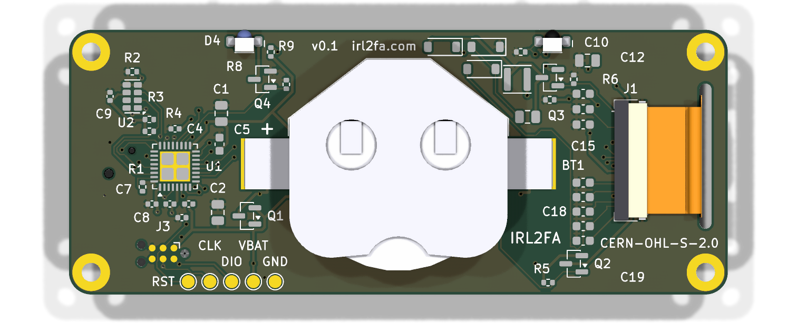

# PCB design

  
  

| | |
|-|-|
| Size | 77 × 31 mm, corner radius 2.6 mm, 0.8 mm FR-4, ENIG finish (the cell's negative contact is a bare pad) |
| Layers | 2, with a ground pour on both |
| Rules | 0.15 mm signal / 0.4 mm power tracks, 0.15 mm clearance, 0.6/0.3 mm vias. Within JLCPCB's standard 2-layer process (board minimum set to their 0.1 mm capability) |
| Assembly | both sides: the joystick on the front, everything else on the back. JLCPCB Standard PCBA as a 1 × 2 panel with edge rails; see [assembly-review.md](assembly-review.md) |
| Files | `hardware/irl2fa.kicad_sch`, `hardware/irl2fa.kicad_pcb` (KiCad 9) |

## Layout

**Front (screen side).**

- The 59.2 × 29.2 mm e-paper glass sits on the left, stuck to the board with 0.2 mm adhesive. Front copper under it is ground pour plus the signal tracks that cross between the two halves of the back.
- The glass is 0.9 mm from the top and bottom edges and 5.3 mm from the left edge: the case's left screw bosses (r 2.3 mm) sit beside it with 0.4 mm to spare.
- The Alps joystick is on the right, rotated 45° because its contacts sit at the body's corners. Its corner is 1.2 mm from the glass and 0.7 mm from the board edge. Its courtyard follows the body and pads (a cross, not a bounding box), which is what lets it sit that close to the glass.
- `hardware/pins.yaml` maps the four contacts to up, down, left and right.

**Back, left to right.**

- **The display's flex cable** comes through a 1.4 × 14 mm slot just left of the glass. It plugs into the Hirose FH34 connector (J1), which opens towards the slot. The panel's pin 1 is at the top, so after the 180° fold it is still at the top, and `gen_pcb.py` checks that the connector's pin 1 is too.
- **The e-paper booster** sits in the top-left corner: L1, Q3, D1-D3, C10, C11, R6, R7. The panel's decoupling capacitors (C12-C19) are in a column beside J1. The column has a gap level with J1's signal pins, so they can escape towards the MCU.
- **The CR2450 clip** (MYOUNG MY-2450-01, 5.7 mm high) is in the middle. The cell lies flat on the board: its negative face sits on a bare 12 mm copper pad (BT1 pad 2, GND), and the clip's sprung plate presses its positive face and is soldered down at both sides. The closed end of the clip points at the IR edge. The cell slides in from the bottom edge, so the strip below the cell holds no parts, only silkscreen. A rule area keeps vias out from under the cell: its can slides over the board, and a via with imperfect tenting could short it. Tracks under solder mask are allowed. The courtyard follows the clip plate, the cell circle and the feet, so the corners the round cell leaves free can hold parts.
- **On the right:**
  - the MCU (U1) with its decoupling
  - the RTC (U2)
  - the reverse-battery FET (Q1) and bulk capacitors (C1, C2)
  - the Tag-Connect TC2030 programming pads (J3)
  - the test points TP1 (VBAT) and TP2 (GND), for measuring sleep current with a meter in series with the cell
- **IR emitter and detector.** Both are side-looking and sit on the back at the **top edge**: the emitter (D4) at x = 56.5 mm and the detector (Q5) at x = 20.5 mm, mirrored about the centre line. Two devices held top edge to top edge, one turned 180°, line up the emitter of one with the detector of the other. The lens tips are flush with the board edge.

**Mounting.** Four M2 plated holes, tied to ground, at the corner radius centres (2.6 mm in from each edge, so the 4.4 mm pads keep 0.4 mm of board around them).

## How the board was made, and how to change it

The first version of the schematic and PCB was generated from
`hardware/tools/design.py` by `hardware/tools/build_pcb.sh`:

1. `gen_schematic.py` writes the schematic. Every pin gets a wire stub and a net label, and symbols come from KiCad's stock libraries plus `hardware/lib/irl2fa.kicad_sym`.
2. `gen_pcb.py` places the footprints from the netlist, draws the outline and edge keepouts, exports Specctra DSN, and imports the routes.
3. [Freerouting](https://github.com/freerouting/freerouting) autoroutes the board in Docker, with extra passes that start from the previous routes until everything is connected.
4. `gen_pcb.py` adds the ground pours on both layers and fills them.
5. `gen_pcb.py --step silk` places every reference designator and the board markings where they can be read: clear of pads, other silkscreen, part bodies, the coin cell and its insertion path, the FPC slot and the board edge. A label with no such place is hidden; the [interactive BOM](https://irl2fa.com/ibom.html) still identifies the part. It only moves silkscreen text, so it can be re-run on a hand-edited board.
6. ERC and DRC with schematic parity must come back clean, silkscreen included.

`gen_pcb.py --step refresh` updates the board's copies of our own footprints from `hardware/lib` after a silkscreen or fab-layer change (it refuses if a pad moved), and `hardware/tools/render_pcb.sh` regenerates the images in `docs/images/pcb`.

**Back-side placement mirrors parts top to bottom.** A part placed on the back at rotation 0 has its footprint's top edge at the bottom. That matters for any part with a direction the copper doesn't show. The side-looking IR LED and phototransistor are placed at 180° so their lenses face out through the top edge, and `hardware/tests/test_orientation.py` checks it. (Up to this change they were placed at 0°, facing into the board; the symmetric pads hid it from ERC, DRC and the footprint checks.)

**The placement file is not KiCad's.** JLCPCB places parts from its own library footprints and reads back-side angles as seen from the back, so `hardware/tools/fab.py` turns KiCad's angle `a` into `180 - a` on the back and adds a per-part correction where JLCPCB's footprint is drawn differently from ours (SOT-23 and SC-70 by 180°, the RV-3032 by 270°, the FPC connector's origin by 1.25 mm). The table is `fab.JLC`, with the evidence for each part; `hardware/tests/test_assembly.py` places JLCPCB's pads with the generated file and checks each lands on ours. A new part needs an entry there. See [assembly-review.md](assembly-review.md).

**From now on, the KiCad files are the source.** Open them in KiCad 9 and edit them like any project. Hand-tidy the autorouted tracks if you like: CI checks the result, not how it was made. `build_pcb.sh` overwrites both files, so only re-run it if you want to start again from `design.py`.

Footprints, symbols and 3D models for the parts KiCad doesn't ship were drawn from the manufacturers' datasheets by `hardware/tools/gen_footprints.py` and `gen_models.py`. See [hardware/lib/README.md](../hardware/lib/README.md) for sources and dimensions.

## Checks

Every push runs the following. Details are in [hardware-testing.md](hardware-testing.md).

- ERC
- DRC with schematic parity, with silkscreen overlaps, silkscreen on pads and silkscreen at the board edge as errors
- the IR parts facing out through the top edge
- JLCPCB's own footprints, placed with the CPL, landing on ours pin for pin; fine-pitch mask dams, paste, tenting and stock
- netlist against `pins.yaml`
- SPICE benches
- the power budget
- a check that the fab outputs are current
- Gerber checks
- the case fit test

## Things to verify on the first boards

These are modelled or taken from datasheets but not yet measured:

1. **E-paper image orientation.** The firmware assumes the panel's RAM origin from Good Display's drawing. If the picture is upside down, build with `-DEPD_ROTATE_180=ON`.
2. **IR range and speed.** The plan is 4800 baud, set by the phototransistor's 20-40 µs edges. With worst-case datasheet parts the link reaches about 3 cm on axis (`hardware/spice/ir_rx.cir`); typical parts reach further. Also try it under a desk lamp and near a window: the detector has no daylight filter ([electrical review](electrical-review.md) IR-1).
3. **Sleep current.** The budget is about 1.2 µA typical; measure at TP1/TP2.
4. **Joystick direction mapping** after the 45° rotation. If it's wrong, fix it in `pins.yaml` and regenerate `pins.h`.
5. **Fit of the FPC fold.** See [mechanical-review.md](mechanical-review.md). The flex is 14.3 mm wide (not 12.5) for its first ~4 mm, which is where it passes the slot (MECH-01: the slot must grow before the first order). Its 14.3 mm length is 2-3.5 mm more than the path from the glass round the slot into J1 needs, so the spare forms a loose loop under the board; the 6 mm stiffener lies flat into J1. Check that the loop does not pull on J1, and that pin 1 lines up (both at y = 9.55).
6. **Coin-cell contact.** The cell's negative face rests on a bare ENIG pad. Check that the clip holds the cell firmly, that the pad (not the solder mask over the tracks round it) carries the cell (MECH-04), and that inserting it (sliding in from the bottom edge) does not scrape the solder mask.
