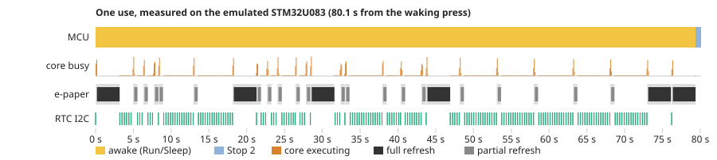

# Power calculations

_Generated by `hardware/power/power.py` from the datasheet constants in `hardware/power/model.json` and the emulator measurements in `hardware/power/measured.json`. CI re-measures on every push and fails if the firmware's behaviour drifts or the worst case at 20 uses a day drops below 1 year._

Battery: **CR2450**, 540 mAh usable (620 mAh nominal), 1.0 %/year self-discharge.

## Where the numbers come from

- **How long each part is on** is measured: the release firmware runs in Renode (`firmware/renode/power.robot`) through a scripted use and a pairing, and `firmware/renode/models/PowerMonitor.cs` records MCU Stop 2 entries and time, instructions executed, e-paper supply and BUSY periods, SPI bytes, RTC I2C transactions and every IR byte.
- **How much current each part draws in each state** comes from datasheets (`model.json`, with sources below).

## Sleep current

| Contributor | Typical (µA) | Worst (µA) | Source |
|-|-|-|-|
| mcu_stop2 | 0.90 | 2.00 | STM32U083 DS14548: Stop 2 without RTC 695 nA @ 1.8 V; scaled to 3 V |
| rtc_rv3032 | 0.16 | 0.21 | RV-3032-C7 datasheet: 160 nA typ / 210 nA max @ 3 V |
| epd_switch_off | 0.01 | 1.00 | AO3401A IDSS 1 uA max at -30 V; nA at 3 V |
| bulk_cap_leak | 0.10 | 2.80 | 2x 47 uF X5R: insulation resistance >= 100 Mohm.uF |
| reverse_fet_gate | 0.00 | 0.10 | AO3401A IGSS 100 nA max |
| **Total** | **1.17** | **6.11** | |

## One use, measured

The script: wake with a press, open the contact and read the SAY/HEAR words for 10 s, back to the menu, open Codes, page down two accounts, open a code for 6 s, page through two more codes, then leave it until the firmware's 30 s idle timeout puts it in Stop 2. That is a long use (words *and* a code), so the budget errs high.

| | Use | Pairing |
|-|-|-|
| Awake (wake press to Stop 2) | 74.3 s | 60.1 s |
| Core executing (instructions / 16 MHz) | 2.933 s (46,923,296 instr.) | 3.878 s (62,047,833 instr.) |
| Core in WFI (Sleep mode) | 71.4 s | 56.3 s |
| Full / partial refreshes | 3 / 17 | 2 / 14 |
| E-paper BUSY (full + partial) | 16.14 s | 11.88 s |
| E-paper powered, not refreshing | 2.97 s | 2.37 s |
| SPI to the panel | 160,780 B (161 ms at 8 MHz) | 128,624 B (129 ms) |
| RTC I2C transactions | 388 (2134 B) | 330 (1815 B) |
| IR receiver on / LED lit | 0.0 s / 0.00 s | 22.1 s / 2.58 s (2398 B sent) |
| Stop 2 entries | 1 | 1 |

## Charge

| Contributor | Current typ / worst | Use: typ / worst (mA·s) | Pairing: typ / worst (mA·s) |
|-|-|-|-|
| MCU running | 1.2 / 2.0 mA | 3.71 / 6.19 | 4.81 / 8.01 |
| MCU in WFI | 0.35 / 0.6 mA | 24.97 / 42.81 | 19.69 / 33.75 |
| e-paper refreshing | 3.5 / 5.0 mA | 56.49 / 80.70 | 41.58 / 59.40 |
| e-paper powered, not refreshing | 0.3 / 1.0 mA | 0.89 / 2.97 | 0.71 / 2.37 |
| RTC I2C | 0.32 / 0.64 mA | 0.06 / 0.12 | 0.05 / 0.10 |
| IR LED | 18 / 25 mA | 0.00 / 0.00 | 46.35 / 64.38 |
| IR receiver | 0.1 / 0.3 mA | 0.00 / 0.00 | 2.21 / 6.62 |
| **Total** | | **86.1 / 132.8** | **115.4 / 174.6** |

### Current sources

- **MCU running:** STM32U083 at 16 MHz HSI16, range 1, code from flash: 52 uA/MHz headline (DS14548 p.1, 1.8 V, range 2) is 0.83 mA; 1.2 mA allows for range 1, 3 V and HSI16. Not yet checked against the DS14548 Run-mode table.
- **MCU in WFI:** Sleep mode (WFI) at 16 MHz with HSI16 and SysTick running: estimate, about 30 % of Run as on other Cortex-M0+ STM32s. Not yet checked against the DS14548 Sleep-mode table.
- **e-paper refreshing:** GDEY0213B74 typical operating current 3.5 mA @ 3 V (during a refresh)
- **e-paper powered, not refreshing:** SSD1680 powered with the analog block off (reset, register and RAM writes): assumption, no datasheet figure for this state
- **Refresh times:** GDEY0213B74: full refresh 3 s, partial 0.42 s @ 25 C. The emulated SSD1680 holds BUSY this long, so these also set the measured BUSY time.
- **RTC I2C:** two 4.7 kohm pull-ups at 3 V (0.64 mA each when pulled low), low about a quarter of the bit time on average; worst: half
- **IR LED:** VSMB2948SL through 100 ohm and AO3400A: 18 mA at 3 V; hardware/spice/ir_led.cir limits it to 25 mA on a fresh cell
- **IR receiver:** VEMT2523SLX01 emitter follower into 10 kohm: photocurrent only, at most 3 V / 10 kohm = 0.3 mA when lit; dark current is nA

## Battery life

| Profile | Uses/day | Pairings/year | Typical: mAh/year | Typical: years | Worst: mAh/year | Worst: years |
|-|-|-|-|-|-|-|
| light | 5 | 2 | 54 | 9.1 | 121 | 4.3 |
| normal | 20 | 6 | 185 | 2.8 | 323 | 1.6 |
| heavy | 60 | 12 | 535 | 1.0 | 862 | 0.6 |

At 20 uses a day (typical currents) the year's 185 mAh splits into 10 mAh of sleep current, 175 mAh of uses and 0.2 mAh of pairings.

## How the measurement changed the firmware

- **v0.1 budget, before any measurement:** a use assumed to be 40 s awake with 2 full and 3 partial refreshes (63 mA·s typical): 3.7 years typical, 2.1 worst case at 20 uses a day.
- **First emulator measurement:** 77 s awake with 5 full and 20 partial refreshes (113 mA·s): 2.2 / 1.3 years, and heavy use (60 a day) under a year (0.8). The contact, code and code-list screens redrew every 5 s for their countdown bars, and every sixth redraw was a 3 s full refresh, for as long as the screen stayed up.
- **Now** (`firmware/core/app.c`): a screen is redrawn when its content changes (words every 15 s, codes every 30 or 60 s); the countdown bar moves in thirds of the period with partial refreshes that never trigger a full one; a full refresh comes on the first content change after 5 partial ones; waking is a partial refresh because the sleep screen's full refresh left the panel clean; the sleep screen stays a full refresh so nothing sensitive is left on the glass. The same use is now 74 s awake with 3 full and 17 partial refreshes (86 mA·s): 2.8 years typical and 1.6 worst case at 20 uses a day, and 1.00 years typical at 60 a day, so heavy use is still just short of a year. The next lever is the MCU waiting in Sleep mode at 16 MHz while awake (29 % of a use, with a current that is still an estimate): idling in Stop 2 between polls, with a low-power timer as the time base, is a port change of its own.
- **The clock** (`firmware/port/stm32u0/rv3032.c`): the RTC driver returned the second it last read for up to 250 ms, so just after a boundary a screen could show the previous code or word and redraw a moment later, an extra refresh. It now counts on from the RV-3032's hundredths with the millisecond tick. Found by replaying the measured use in the simulator, whose clock is exact.
- **Pairing** listens before it talks, so frames rarely collide, and gives up after 60 s; the LED is lit for about 12 % of the IR-on time.

## What is still an assumption

- **The e-paper current waveform.** The panel is modelled as a flat 3.5 mA for the whole BUSY time, which is itself the datasheet refresh time (3.0 s full, 0.42 s partial): the emulated SSD1680 holds BUSY exactly that long. The real booster draws pulses of 10-20 mA, and the refresh takes longer in the cold. The first board should be measured with a current probe across a full and a partial refresh.
- **MCU Run and Sleep currents** are estimates from the STM32U0 headline figures (see the sources above), not yet read off the DS14548 tables or measured.
- **Cycles per instruction.** Renode advances 1/16 µs per instruction. A real Cortex-M0+ needs 1-3 cycles for loads, stores and branches, so the true run time is up to about 2x the measured one. Run time is a small share of the total, so this moves a use by a few percent.
- **SPI and I2C wire time.** The emulated buses are instantaneous; their wire time is computed from the byte counts and charged at the Run current.
- **The use script.** Real uses vary; the scripted one includes both the words and a code and the full idle timeout, so it is on the long side. Pressing left on the home menu sleeps at once and saves most of the idle time.
- **Sleep current** is from datasheets (Stop 2, RTC, leakage); Renode does not model it. The first board's sleep current is the number to check.

Battery life is capped in practice by the cell's shelf life (about 10 years) and by the e-paper's 0 °C lower limit in cold pockets, not by the electronics.

Peak current is the other limit: a coin cell's internal resistance rises as it empties. `hardware/spice/battery_pulse.cir` checks that a refresh still works with a half-used cell (40 Ω), and the firmware shows the battery level from VREFINT.
