# User interface

The 5-way joystick is the **only control**: ↑ ↓ ← → and a centre push (●).
The rules are the same on every screen:

| Input | Meaning |
|-|-|
| ↑ ↓ | move / change a value (hold to repeat) |
| → or ● | open / select |
| ← | back (on the home menu: sleep now) |
| ● | confirm / options |

The device sleeps after 30 s without input. Before it does, it draws a
neutral sleep screen with a full refresh, so no code or word stays visible on
the e-paper. Any press wakes it. If a PIN is set, it asks for the PIN first.
In [simple mode](#vulnerable-simple-mode) the rules are different: only ↑ ↓
do anything.

**Refreshes.** The e-paper takes 0.42 s for a partial refresh and 3 s for a
full (flashing) one, and the device cannot react in that time, but no press
is lost: presses made during a refresh are handled after it, two presses as
two presses. To keep the battery going (see
[power-calculations.md](power-calculations.md)) the screen is redrawn only
when something on it changes:

- **Words** change every 15 s and **codes** every 30 or 60 s; the codes list
  follows its codes. The **countdown bar** under the words or a code moves in
  thirds of the period (5 s for words, 10 s for 30 s codes) with partial
  refreshes only.
- After 5 partial refreshes, the next change of content (a press, a new
  word or code) is a full refresh, which clears the ghosting partial
  refreshes leave. Countdown-bar steps never trigger one.
- Waking is a partial refresh: the full one that drew the sleep screen left
  the panel clean. The first screen after power-up is a full refresh.

**Pairing** gives up after a minute if no other device answers ("No other
device found") and goes back to the menu. It keeps the device awake while
the two people compare the symbols and name each other, for at most three
minutes; after that the usual 30 s idle timeout applies, so a device left on
a pairing screen still goes to sleep.

Every screen below is a real render from the firmware (`firmware/tools/screens.py`).

## Map

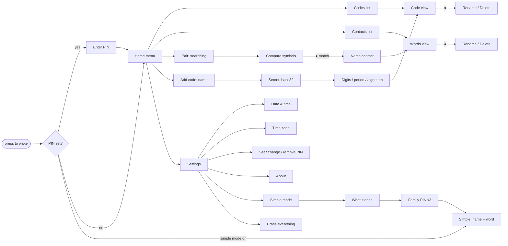

## Screens

| | |
|-|-|
| 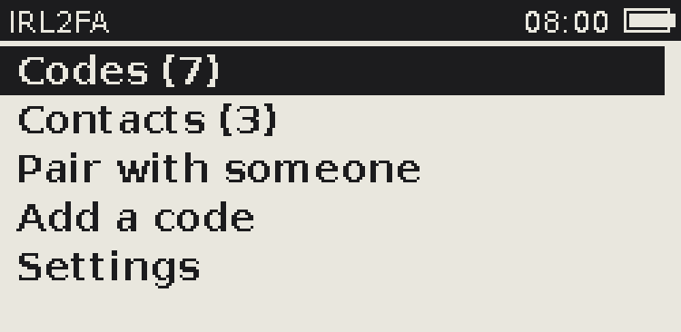 **Home.** Counts of codes and contacts. | 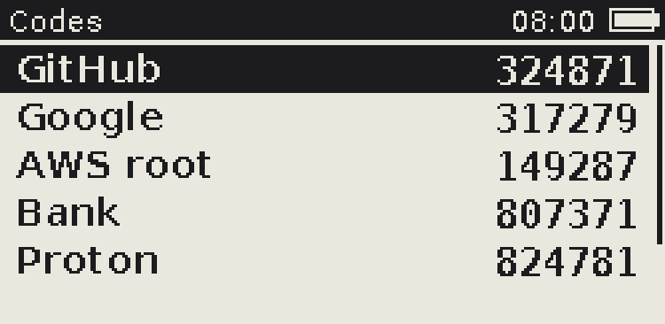 **Codes.** Live codes next to each label. |
|  **Code.** Big digits and time left. ↑↓ jumps to the next code. |  **Words.** SAY your word, HEAR theirs. "or …" is the previous window's word. |
| 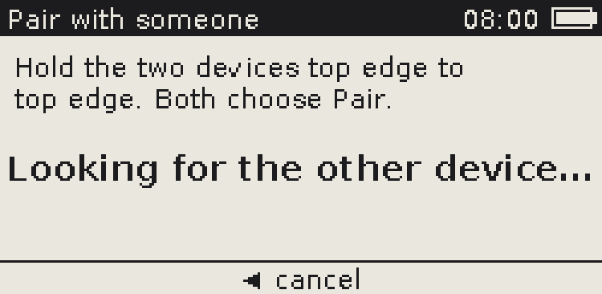 **Pairing.** Hold the top edges together. | 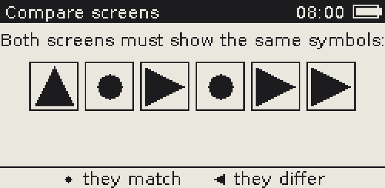 **Compare.** Both screens must show the same six symbols. |
| 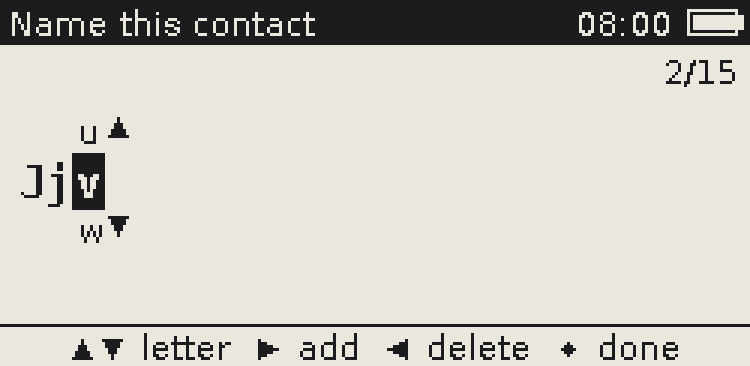 **Text entry.** ↑↓ picks a character from the wheel, → adds it, ← deletes, ● finishes. | 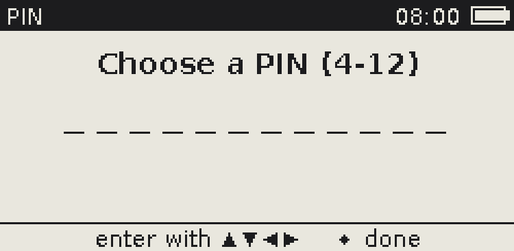 **PIN.** A sequence of 4 to 12 joystick directions. |
| 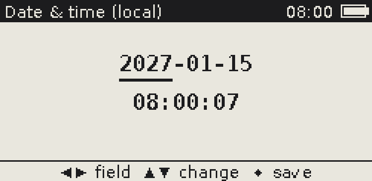 **Date & time.** ←→ selects a field, ↑↓ changes it. | 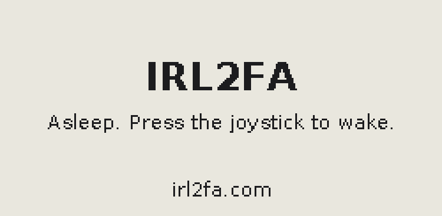 **Asleep.** Shows nothing sensitive. |
| 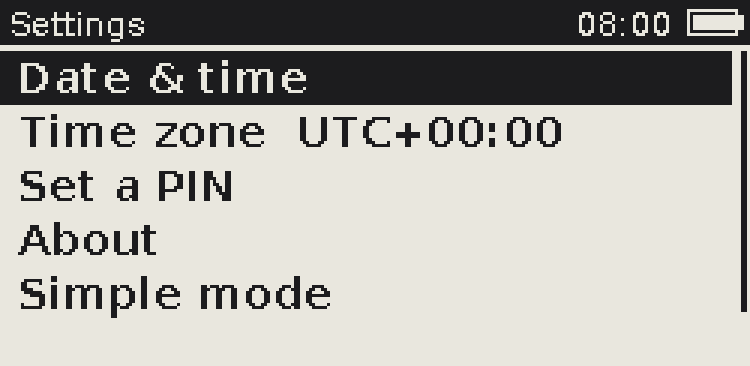 **Settings.** Clock, PIN, simple mode, erase. | 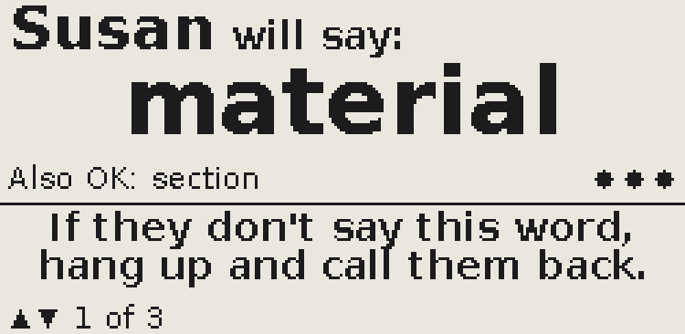 **Simple mode.** Who is calling and the word they will say. |

## Vulnerable (simple) mode

For someone who should only ever check who is on the phone: a grandparent, a
child, anyone a scammer might call pretending to be family. On the device it
is called **Simple mode**. It is one-way: the device checks the caller, it
never proves itself. The family member's own device is not changed at all;
they read out their SAY word as usual.

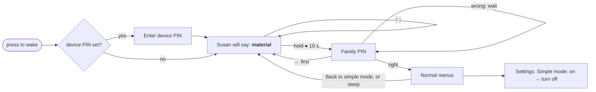

**Setting it up** (on the device that will be given away):

1. Pair it in person with each family member who might call, and name each
   contact the way the person thinks of them ("Susan", "Grandpa Joe"). Up to
   15 characters; long names are shortened on screen.
2. **Settings → Simple mode.** One screen says what it does. ● to go on.
3. Choose a **family PIN** of 6 to 12 joystick moves (the first move cannot be
   ←, which means back) and enter it twice more. There is no way to reset it:
   write it down somewhere safe.
4. The device says "Simple mode is on" and from then on wakes straight to the
   first contact.

**What it shows.** No title bar, menus, codes or clock. The contact's name
large, "will say:", and their word very large (the device's HEAR word, in a
34 px font). Under it, "Also OK:" with the previous window's word, since the
word may change while they are talking; then, in plain words, "If they don't
say this word, hang up and call them back." The bottom line shows "↑↓ 2 of 4"
when there is more than one person, and "Battery low: tell your family" when
the cell is below 2.55 V. Three dots empty as the word's 15 s go by (no
numbers). The device's own SAY word is never drawn.

| | |
|-|-|
|  **A contact.** ↑↓ goes to the next person (it wraps). Nothing else does anything. |  **Low battery,** in words. |
|  **Nobody paired yet.** If the clock has lost the time it says "The clock needs setting" instead of showing wrong words. |  **Holding ●.** After 3 s it says to keep holding; at 10 s the family PIN. |
| 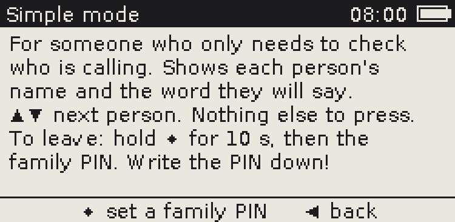 **Settings → Simple mode.** What it does, before the family PIN. | 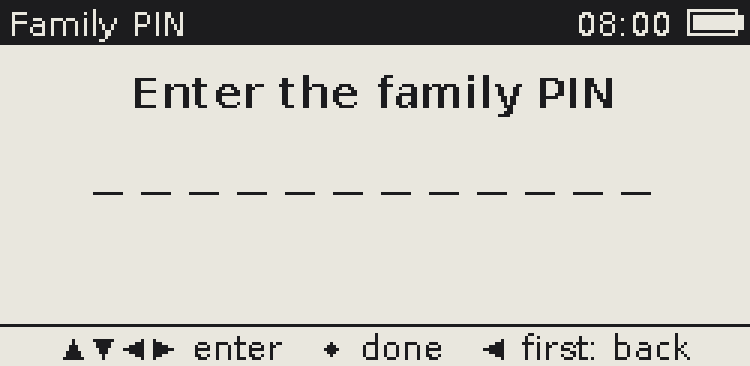 **Family PIN.** ← on an empty PIN goes back. |

**Getting out.** Hold the centre for 10 seconds, then enter the family PIN.
That opens the normal home menu, where the family can pair someone new,
rename or delete contacts, and add codes. Simple mode stays on: the home menu
has **Back to simple mode**, and the device returns to it whenever it sleeps.
To turn it off: **Settings → Simple mode: on**, and confirm.

**Wrong family PINs** never erase anything (a wiped device would leave the
person without their contacts, which is the harm the mode exists to prevent).
Instead each wrong PIN after the third costs a wait: 30 s, 1, 2, 5, 10 and 30
minutes, then an hour each. The wait is counted on the real-time clock and
written to flash with every try, so it holds across sleep, a reset or pulling
the battery. If the clock goes backwards (a battery change resets it), the
wait starts again from the new time: never shorter, never a lockout. Entries
shorter than 6 moves are not counted as tries.

**Redraws** follow the same policy as the normal words screen: a content
redraw when the word changes every 15 s, the dots move with partial
refreshes that never trigger a full one, and there is no clock to redraw
every minute. ← → and a short ● press do not redraw at all.

**Security trade-offs.**

- *Brute force without a wipe.* 4^6 = 4096 six-move PINs; after the first
  three tries the waits add up to about an hour per guess, so working through
  them takes months of someone holding the button and entering moves. A
  longer PIN multiplies that by 4 per move. Ten wrong PINs erasing the device
  would be stronger against a thief but is exactly wrong here.
- *The family PIN only gates the screens.* It does not encrypt anything and
  is separate from the device PIN. Its verifier (Argon2i of the PIN, compared
  in constant time) is sealed under the store's master key in the settings
  page, with the on/off flag beside it, so both change in one atomic page
  write. Anyone who could read the flash past the MCU's readout protection
  has every key anyway.
- *A device PIN still applies on wake*, with its ten-tries erase. On a device
  for someone who might forget it, don't set one: simple mode is about
  impostors on the phone, not theft of the device.
- *Forgotten family PIN.* There is no reset, only guessing with the waits.
  That is why it is entered three times at setup.
- *A damaged settings page* (a verifier that no longer decrypts) turns simple
  mode off at the next family PIN try rather than locking the family out for
  good. Changing the flash means the attacker already has everything.
- *Telling the person to hold the button.* Anyone can learn that a 10 s hold
  asks for a PIN (the screen says to keep holding). It only ever leads to the
  family PIN and its waits.

## Entering a TOTP secret

Services show a QR code and, usually behind a "can't scan it?" link, the
same secret as base32 text (for example `JBSWY3DPEHPK3PXP`). Enter that text:

1. Home → **Add a code** → type a label (up to 15 characters).
2. Type the secret. The wheel only offers base32 characters (A-Z, 2-7), and
   spaces in the service's display can be skipped. 16 to 32 characters is
   typical.
3. Options: 6 or 8 digits, 30 or 60 s, SHA1/SHA256/SHA512. Nearly every
   service uses the defaults (6, 30 s, SHA1), so just press ●.
4. Compare the first code with the one the service asks for to finish setup.

Tip: hold ↑ or ↓ to spin the wheel quickly. After a delete, the wheel starts
on the character you deleted, so fixing a typo takes one press.
