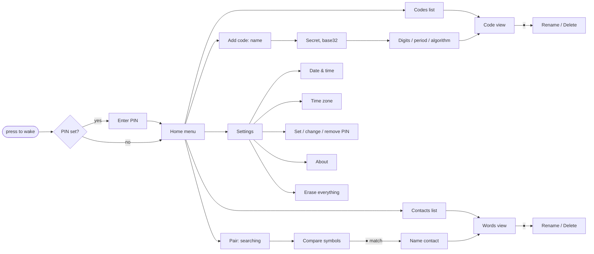

# User interface

The 5-way joystick is the **only control**: ↑ ↓ ← → and a centre push (●).
The rules are the same on every screen:

| Input | Meaning |
|-|-|
| ↑ ↓ | move / change a value (hold to repeat) |
| → or ● | open / select |
| ← | back (on the home menu: sleep now) |
| ● | confirm / options |

The device sleeps after 30 s without input. Before it does, it draws a
neutral sleep screen with a full refresh, so no code or word stays visible on
the e-paper. Any press wakes it. If a PIN is set, it asks for the PIN first.

**Refreshes.** The e-paper takes 0.42 s for a partial refresh and 3 s for a
full (flashing) one, and the device cannot react in that time, but no press
is lost: presses made during a refresh are handled after it, two presses as
two presses. To keep the battery going (see
[power-calculations.md](power-calculations.md)) the screen is redrawn only
when something on it changes:

- **Words** change every 15 s and **codes** every 30 or 60 s; the codes list
  follows its codes. The **countdown bar** under the words or a code moves in
  thirds of the period (5 s for words, 10 s for 30 s codes) with partial
  refreshes only.
- After 5 partial refreshes, the next change of content (a press, a new
  word or code) is a full refresh, which clears the ghosting partial
  refreshes leave. Countdown-bar steps never trigger one.
- Waking is a partial refresh: the full one that drew the sleep screen left
  the panel clean. The first screen after power-up is a full refresh.

**Pairing** gives up after a minute if no other device answers ("No other
device found") and goes back to the menu. It keeps the device awake while
the two people compare the symbols and name each other, for at most three
minutes; after that the usual 30 s idle timeout applies, so a device left on
a pairing screen still goes to sleep.

Every screen below is a real render from the firmware (`firmware/tools/screens.py`).

## Map

## Screens

| | |
|-|-|
|  **Home.** Counts of codes and contacts. |  **Codes.** Live codes next to each label. |
|  **Code.** Big digits and time left. ↑↓ jumps to the next code. |  **Words.** SAY your word, HEAR theirs. "or …" is the previous window's word. |
|  **Pairing.** Hold the top edges together. |  **Compare.** Both screens must show the same six symbols. |
|  **Text entry.** ↑↓ picks a character from the wheel, → adds it, ← deletes, ● finishes. |  **PIN.** A sequence of 4 to 12 joystick directions. |
|  **Date & time.** ←→ selects a field, ↑↓ changes it. |  **Asleep.** Shows nothing sensitive. |

## Entering a TOTP secret

Services show a QR code and, usually behind a "can't scan it?" link, the
same secret as base32 text (for example `JBSWY3DPEHPK3PXP`). Enter that text:

1. Home → **Add a code** → type a label (up to 15 characters).
2. Type the secret. The wheel only offers base32 characters (A-Z, 2-7), and
   spaces in the service's display can be skipped. 16 to 32 characters is
   typical.
3. Options: 6 or 8 digits, 30 or 60 s, SHA1/SHA256/SHA512. Nearly every
   service uses the defaults (6, 30 s, SHA1), so just press ●.
4. Compare the first code with the one the service asks for to finish setup.

Tip: hold ↑ or ↓ to spin the wheel quickly. After a delete, the wheel starts
on the character you deleted, so fixing a typo takes one press.
