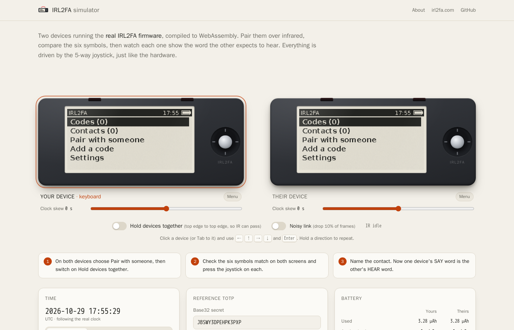
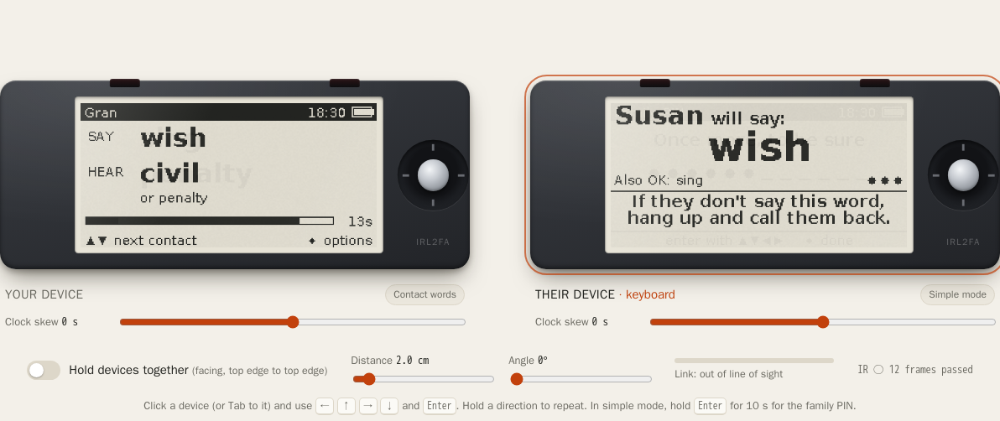

# IRL2FA browser simulator

Two IRL2FA devices in a web page, running the **real firmware**: `firmware/core/`
and the virtual board `firmware/vhal/` compiled to WebAssembly, one instance per
device. Pair them over a simulated IR link, compare the symbols, read each
other's words, add TOTP codes, set a PIN, let them sleep, and watch the battery
estimate.



## Layout

| Path | What it is |
| --- | --- |
| `sim_main.c` | Exported C API (`sim_*`): lifecycle, buttons (with the board's EXTI press latch), time, display (with the panel's BUSY time), IR, energy counters, and sim-only helpers (demo codes, word/code readback, text probe for the tests). |
| `build.sh` | Builds `dist/`: `irl2fa.mjs` + `irl2fa.wasm` (`-sMODULARIZE=1 -sEXPORT_ES6=1 -sENVIRONMENT=web,node`) and copies `web/`. |
| `web/irl2fa-device.js` | `Device` (one WASM instance) and `World` (two devices in lock-step simulated time, the IR link model between them), the energy model and a reference TOTP. Shared by the page and the tests. |
| `web/index.html`, `app.js`, `style.css` | The page. No framework, no build step, no network access beyond its own files. |
| `web/power-model.js` | The battery panel's model, **generated** by `python3 hardware/power/power.py --update` from the datasheet currents and the Renode-measured profile. The tests fail if it is stale. |
| `test/sim.test.mjs` | Node tests driving both devices through the joystick only. |

`dist/` is generated and git-ignored.

## Build

Needs Docker (uses the `emscripten/emsdk:3.1.74` image) or `emcc` 3.1.74 on `PATH`.

```sh
sim/build.sh
```

## Test

Needs Node 22 or later (CI uses 24). Build first.

```sh
node --test sim/test
```

The tests pair two devices over IR (at 2 cm in under 6 s with hardly any
collisions thanks to listen-before-talk, with 10% of frames dropped, and at
8 cm with bit errors), check that pairing keeps retrying at 14 cm and gives
up after a minute so the device can sleep, check the refresh policy (bar
steps partial, wake partial, sleep full, full after 5 partial content
redraws), that a second press during a refresh is not lost, and replay the
Renode power script from the same RTC time with the same press timing:
the refresh sequence must be identical and awake time and charge within
3 % and 5 %. They also
check the SAS screens are identical, name the contacts with the joystick and
check one device's SAY word is the other's HEAR word, both in the store and as
drawn on the panels. They add `JBSWY3DPEHPK3PXP` through the character wheel
and compare the code on screen with an RFC 6238 reference from `node:crypto`,
and cover sleep/wake, a PIN being required after wake, and the energy counters.
One device is turned into a simple-mode device through its own Settings: the
test checks it shows the other device's SAY word large and its own SAY word
nowhere on the panel (in any firmware font), that ← → ● do nothing (not even
a redraw), that it wakes into simple mode, and that a 10 s centre hold and
the family PIN (wrong, then right) lead back to the menus.



## Run

```sh
python3 -m http.server 8000 --directory sim/dist
# open http://localhost:8000/
```

It has to be served over http(s). Opening `index.html` as a file will not load
the WebAssembly.

Controls: click or tap the joystick (hold a direction to auto-repeat). On
narrow screens there is a larger touch pad under each device. With the keyboard,
focus a device (click it or Tab to it) and use the arrow keys and Enter.

## Hardware behaviour

- **E-paper.** `hal_display_show()` blocks on the board until the panel drops
  BUSY: 3 s for a full refresh, 0.42 s for a partial one
  (`hardware/power/model.json`), plus the STM32's own time per refresh
  (drawing the screen, then the driver: supply on, resets, RAM transfer;
  `epd.overhead_s`, measured in Renode). The simulator holds the device busy for that long: the core does
  not poll, and a press is latched (as the EXTI edge latch on the board does)
  and handled afterwards, by the same filter as on the board
  (`firmware/core/buttons.c`), so a second press is a second press. The page draws
  a full refresh as the panel's flashing waveform (old image inverted, black,
  white, black, white, new image inverted, new image) and a partial one as a
  short flicker of the changed pixels that leaves a faint ghost; ghosting
  accumulates over partial refreshes and a full refresh clears it. The
  firmware chooses which: full on power-up and on sleep, and on a content
  change after 5 partial redraws (`FULL_REFRESH_EVERY` in
  `firmware/core/app.c`); countdown-bar steps and waking are partial.
- **IR link** (`IR_LINK` in `web/irl2fa-device.js`). Received signal falls
  with the square of the distance and with the LED's (±25°) and
  phototransistor's (±35°) angular lobes; the bit error rate is the Gaussian
  tail of the resulting signal-to-noise ratio, and weak signals also lose
  whole frames (dropouts). Each byte arrives when its stop bit has (10 bits
  at 4800 baud), as the UART delivers it, so the firmware can hear the other
  device mid-frame and hold its own frame back (listen before talk). The
  link is half duplex: bytes that arrive while the receiver is transmitting
  are garbage. Clean to about 8 cm on axis, marginal at 9 cm,
  nothing beyond about 10 cm: assumptions until a board is measured.
- **Battery** (`web/power-model.js`, generated). The C side counts time
  awake, asleep, with IR on and with the panel busy, and full/partial
  refreshes. The page charges them at the model's per-state figures:

  ```
  charge = awake_s × awake_mA + asleep_s × sleep_uA / 1000 + ir_s × ir_mA
         + full × full_refresh_mAs + partial × partial_refresh_mAs
  ```

  `awake_mA` is the MCU's average over the measured use (running plus WFI,
  RTC I2C), `ir_mA` the LED at its measured duty plus the receiver. The panel
  shows each cell's charge, voltage and remaining life, and fast-forward
  skips days at a usage profile (5, 20 or 60 uses a day), typical or
  worst-case currents, exactly as `hardware/power/power.py` counts them.

## Deployment

`.github/workflows/sim.yml` builds, runs the firmware host tests and these
tests on every push and pull request, and deploys `sim/dist` to GitHub Pages
from `main`. If `sim/web/CNAME` exists it is published as the site's `CNAME`.
